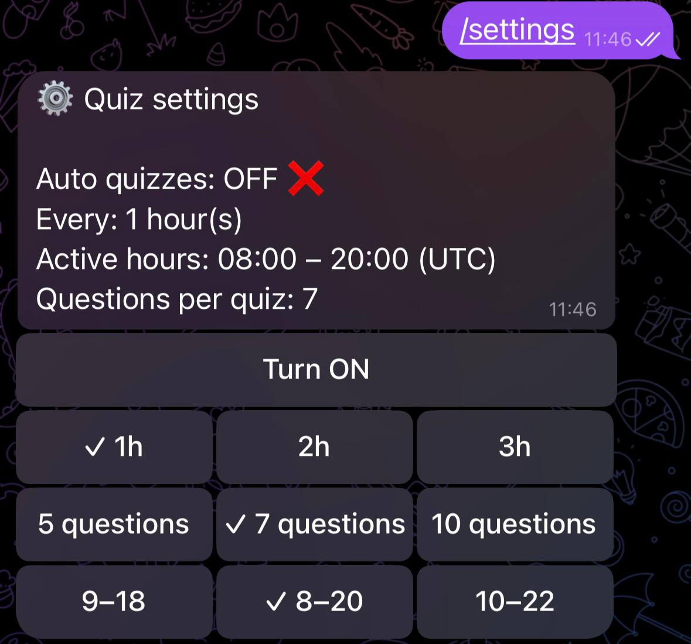
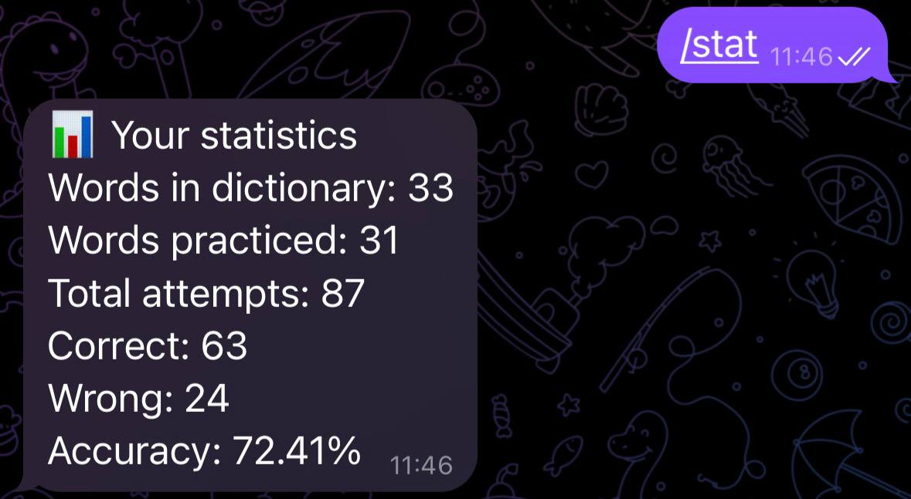
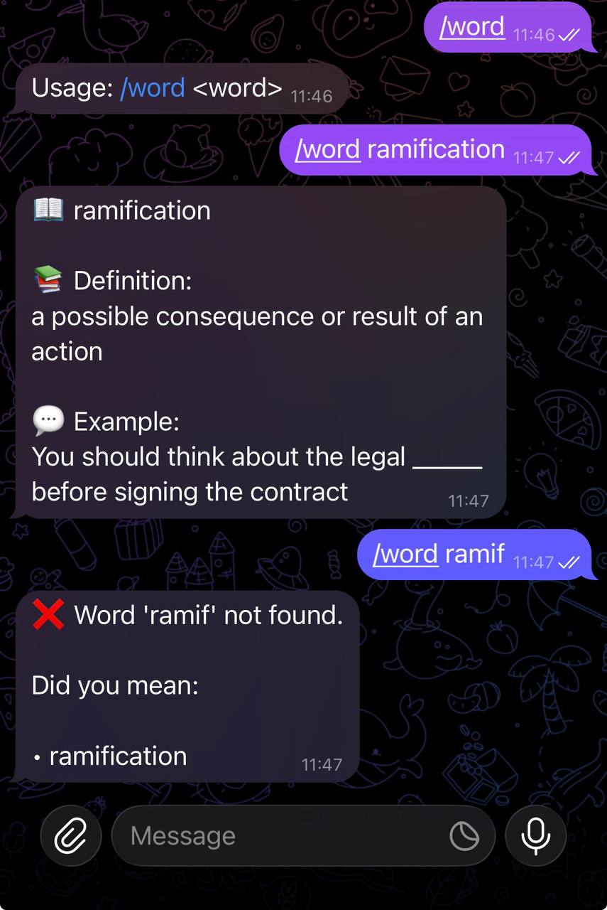
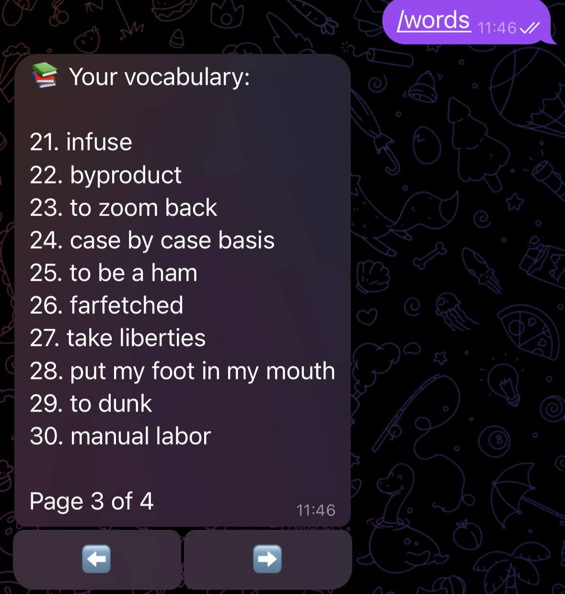

# Vocab Quiz — Telegram vocabulary bot

Telegram bot for **personal vocabulary** and **poll-based quizzes**. Users maintain their own word lists in chat, run manual lessons with `/quiz`, or enable **scheduled auto-quizzes** (interval, daily time window, question count). Answers are stored for basic statistics.

## [Watch demo](https://vimeo.com/1236153988?share=copy&fl=sv&fe=ci)

### Screenshots

<table>
  <tr>
    <td align="center" width="50%">
      <br />
      <sub>Settings</sub>
    </td>
    <td align="center" width="50%">
      <br />
      <sub>Statistics</sub>
    </td>
  </tr>
  <tr>
    <td align="center" width="50%">
      <br />
      <sub>Word lookup</sub>
    </td>
    <td align="center" width="50%">
      <br />
      <sub>Word list</sub>
    </td>
  </tr>
</table>

## Highlights

- **Developed** end-to-end bot flows: add/edit/delete words, paginated word list, lookup, stats.
- **Designed** PostgreSQL schema with **Flyway** migrations; **JPA** entities for users, words, attempts, and per-user quiz settings (1:1).
- **Implemented** quiz engine with distractors, in-memory **multi-step sessions** (add/edit/quiz), and a **cron scheduler** for eligibility-based auto-lessons.
- **Stack:** Kotlin, Java 21, Spring Boot 3, Telegram Bots API (long polling), PostgreSQL, Docker Compose.

## Tech stack

| Area        | Choices                                         |
| ----------- | ----------------------------------------------- |
| Language    | Kotlin                                          |
| Framework   | Spring Boot 3 (JPA, validation, scheduling)     |
| Database    | PostgreSQL 17, Flyway                           |
| Integration | Telegram Bots Java library (long polling)       |
| Tests       | JUnit 5, Mockito, H2 (unit + Spring smoke test) |
| Run         | Gradle, Docker Compose                          |

## Architecture (short)

```
Telegram → TelegramBot → BotDispatcher → Handlers
                              ↓
                    Services → Repositories → PostgreSQL
                    Formatters / TelegramGateway

QuizScheduler (@Scheduled) → enabled users → QuizHandler (same flow as /quiz)
```

Session state for `/add`, `/edit`, and active quizzes lives in memory (single-instance bot). Persistent data: users, words, attempts, settings.

More detail: [vocab-quizz/docs/flow.md](vocab-quizz/docs/flow.md), [vocab-quizz/docs/database.md](vocab-quizz/docs/database.md), [vocab-quizz/docs/challenges-jpa-user-settings.md](vocab-quizz/docs/challenges-jpa-user-settings.md)

## Prerequisites

- **JDK 21**
- **Docker** (recommended) or a local PostgreSQL instance
- A **Telegram bot token** from [@BotFather](https://t.me/BotFather) (`/newbot`)

## Configuration

| Variable                | Required | Description                                                 |
| ----------------------- | -------- | ----------------------------------------------------------- |
| `TELEGRAM_BOT_TOKEN`    | yes      | Bot token from BotFather                                    |
| `TELEGRAM_BOT_USERNAME` | no       | Default: `vocabquizzz_bot` (must match your bot’s username) |

Optional overrides for local runs (see below):

| Variable                     | Example                                       |
| ---------------------------- | --------------------------------------------- |
| `SPRING_DATASOURCE_URL`      | `jdbc:postgresql://localhost:5432/vocab_quiz` |
| `SPRING_DATASOURCE_USERNAME` | `postgres`                                    |
| `SPRING_DATASOURCE_PASSWORD` | `postgres`                                    |

Default `application.yaml` points the datasource at host `postgres` (Docker Compose service name). Override URL when running the app on the host.

Auto-quiz schedule: `quiz.cron` in `src/main/resources/application.yaml` (default: every hour at `:00`). Scheduler uses 6-field Spring cron.

## Run locally (recommended for development)

**1. Start PostgreSQL**

```bash
cd vocab-quizz
docker compose up -d postgres
```

**2. Set the bot token**

```bash
export TELEGRAM_BOT_TOKEN="your-token-from-botfather"
export TELEGRAM_BOT_USERNAME="your_bot_username"   # optional
```

**3. Run the application**

```bash
export SPRING_DATASOURCE_URL=jdbc:postgresql://localhost:5432/vocab_quiz
./gradlew bootRun
```

Flyway applies migrations on startup. Open your bot in Telegram and send `/start` or `/help` after first launch.

## Run with Docker Compose (app + database)

Build the JAR first (the Dockerfile copies `build/libs/*.jar`):

```bash
cd vocab-quizz
export TELEGRAM_BOT_TOKEN="your-token-from-botfather"
./gradlew bootJar
docker compose up --build
```

Stop: `docker compose down`.

## Bot commands

| Command     | Description                                     |
| ----------- | ----------------------------------------------- |
| `/start`    | Welcome text                                    |
| `/help`     | Command list and your question count per lesson |
| `/add`      | Add a word (guided multi-step flow)             |
| `/edit`     | Edit an existing word                           |
| `/delete`   | Delete a word                                   |
| `/word`     | Look up one word                                |
| `/words`    | Paginated list of your words                    |
| `/quiz`     | Start a poll-based lesson                       |
| `/settings` | Auto-quiz and lesson preferences                |
| `/stat`     | Statistics for a word                           |
| `/cancel`   | Cancel active add/edit/quiz session             |

You need at least **4 words** before `/quiz` works. Question count per lesson comes from settings (default 5, range 5–10).

## Tests

```bash
cd vocab-quizz
./gradlew test
```

Force a full re-run (ignore cache): `./gradlew test --rerun-tasks`  
HTML report: `vocab-quizz/build/reports/tests/test/index.html`

**Setup:** H2 in-memory DB for `@SpringBootTest` only; Flyway off; Telegram and scheduler disabled in `src/test/resources/application.yaml`. Most tests are **unit tests** with Mockito mocks (no real Postgres or bot token).

**Mocking style:** we use the **Java Mockito API**, not mockito-kotlin helpers:

```kotlin
import org.mockito.Mockito.mock
import org.mockito.Mockito.`when`

private val wordService: WordService = mock(WordService::class.java)

`when`(wordService.countWords(user)).thenReturn(25)
```

Use backticks on `` `when` `` because `when` is a Kotlin keyword. `verify(...)` comes from `org.mockito.Mockito.verify` where needed.

| Test class                   | What it checks                                  |
| ---------------------------- | ----------------------------------------------- |
| `VocabQuizzApplicationTests` | Spring context loads                            |
| `WordServiceTest`            | Words: validation, CRUD, lookup                 |
| `QuizServiceTest`            | Quiz generation (options, types)                |
| `QuizFlowServiceTest`        | Start/finish quiz flow, attempts, settings mock |
| `StatisticServiceTest`       | User and per-word stats                         |

**Not covered yet:** settings service rules, scheduler, handlers, Flyway against PostgreSQL.

## Project layout

```
src/main/kotlin/.../
  bot/          handlers, formatters, gateway, scheduler, dispatcher
  service/      business logic (words, quiz flow, settings, stats, sessions)
  repository/   Spring Data JPA
  entity/       JPA models
  model/        DTOs, session state, quiz types
  config/       Telegram client, Jackson
src/main/resources/
  application.yaml
  db/migration/ Flyway SQL (V1–V6)
vocab-quizz/docs/  flow, database, JPA notes, test troubleshooting
```

## CI

Tests run automatically via [GitHub Actions](.github/workflows/test.yml):

| Trigger          | When                     |
| ---------------- | ------------------------ |
| **push**         | Every push to any branch |
| **pull_request** | PRs targeting **`main`** |

The workflow uses **Ubuntu**, **JDK 21** (Temurin), and runs from the Gradle module:

```bash
cd vocab-quizz && ./gradlew test --no-daemon
```
